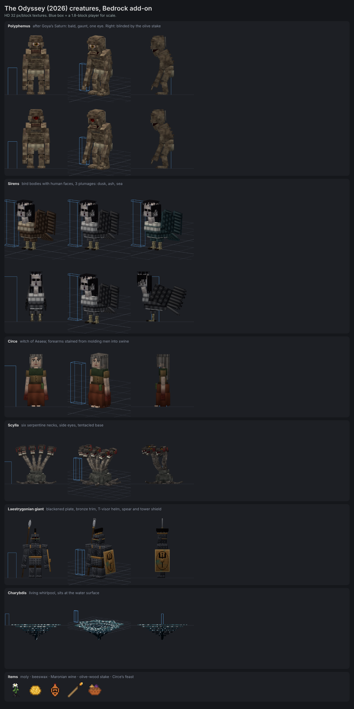

# Minecraft-Addon-Studio

Bedrock add-ons. `BP/` is the behavior pack, `RP/` is the resource pack.

## The Odyssey (2026) creatures

Creatures from Christopher Nolan's *The Odyssey*, each with its own model and HD texture
(32 px per block, painted with film-style lighting) and the mechanic it has in the film.

| Creature | Look | What it does |
|---|---|---|
| **Polyphemus** `studio:cyclops` | Modeled on Goya's *Saturn Devouring His Son*: a bald, gaunt, hunched giant (about 4 blocks tall) with one bulging eye and a gaping mouth | A shepherd: he spawns with a flock of 4 sheep and stays calm until you hurt him or his sheep. When angry he grabs a victim, lifts them to his mouth and bites, and hurls boulders at anyone far away. Give him **Maronian Wine** three times and he falls asleep. Hit him with an **Olive-Wood Stake** while he is drunk or asleep and he is blinded for good: his texture changes, he cries *"Nobody has blinded me!"*, Poseidon sends a thunderstorm and lightning, and from then on he only hears you, so **sneaking** gets you past him. |
| **Siren** `studio:siren` | A bird body with a gaunt human face: black eyes, open singing mouth, ragged wings. Three plumages (dusk, ash, sea) | Flies. Her song plays a flute melody and pulls every player within 24 blocks toward her, with nausea. **Beeswax** blocks the song for 5 minutes. If you are riding a boat, you are "tied to the mast": you still hear the song but are not pulled. |
| **Circe** `studio:circe` | Witch of Aeaea in rough-spun clothes, long greying hair, forearms stained from her work | Neutral. She keeps 3 "Transformed Sailors" (pigs). Ask her for food and she gives you **Circe's Feast**, which makes you pliable. If she touches a villager or illager, she molds them into a pig. If she touches a player, they become a pig for 30 s (60 s after eating her feast). Eat **Moly** first: her magic fails, and if you hit her she yields, turns every pig back into a person, lifts curses, and gives counsel when you talk to her. |
| **Scylla** `studio:scylla` | Six serpentine necks with toothed snouts and glowing side eyes on a barnacled, tentacled body | Amphibious. Every 9 s she snatches up to six victims (one per head), lifts them into the air, bites them, then throws them. Charybdis appears nearby when she spawns. |
| **Charybdis** `studio:charybdis` | A living whirlpool of churning water rings sitting at the surface | Drags players, mobs and boats into a spiral. It swallows boats and items at its center and drowns anything there. |
| **Laestrygonian giant** `studio:laestrygonian` | Armored giant in blackened plate with bronze trim, a T-visor helm, a horsehair crest, spear and tower shield | Throws boulders that **sink boats** (boats are his first target), charges with his spear, and arrows glance off his shield. |

### Items and recipes

| Item | Recipe | Use |
|---|---|---|
| Maronian Wine | 2 sweet berries + glass bottle | Use on Polyphemus: 3 cups put him to sleep |
| Olive-Wood Stake | flint over 2 sticks (vertical) | Hit a drunk or sleeping Polyphemus to blind him |
| Beeswax | honeycomb, makes 2 | Eat: immune to the Sirens' song for 5 minutes |
| Moly | lily of the valley + ink sac | Eat: immune to Circe's magic for 5 minutes |
| Circe's Feast | given by Circe | Restores hunger, but leaves you pliable |

### Play the film

1. **The cave:** find Polyphemus in windswept hills. Craft wine, offer three cups, then use the stake. Sneak past the blind giant.
2. **Aeaea:** summon Circe. Eat moly before she touches you, then hit her to win your crew back.
3. **The Sirens:** stony and sandy shores. Eat beeswax, or sail past in a boat bound to the mast.
4. **Scylla and Charybdis:** deep ocean. Choose which one to sail past.
5. **Telepylus:** Laestrygonians on cold shores. Keep your boats out of throwing range.

Natural spawns: Sirens on beaches, Polyphemus in windswept hills, Laestrygonians on cold beaches,
Scylla in deep oceans. Circe and Charybdis only come from spawn eggs (Charybdis also arrives with Scylla).

### Install and test

Copy `BP/` into `development_behavior_packs` and `RP/` into `development_resource_packs`, then enable both on a world.
The script uses the stable `@minecraft/server` 1.11.0 API, so no experimental toggles are needed.

    /summon studio:cyclops
    /summon studio:siren
    /summon studio:circe
    /summon studio:scylla
    /summon studio:charybdis
    /summon studio:laestrygonian
    /give @s studio:maronian_wine 3
    /give @s studio:olive_stake

### Files

- Models, textures, animations, entity and item JSON are generated by `tools/odyssey_gen.py` (`python3 tools/odyssey_gen.py`).
- Mechanics are in `BP/scripts/main.js`.
- `tools/preview_render.js` renders model previews with three.js (`npm i three playwright` first).

## studio:pixel_slime

The original test entity: `/summon studio:pixel_slime`.
