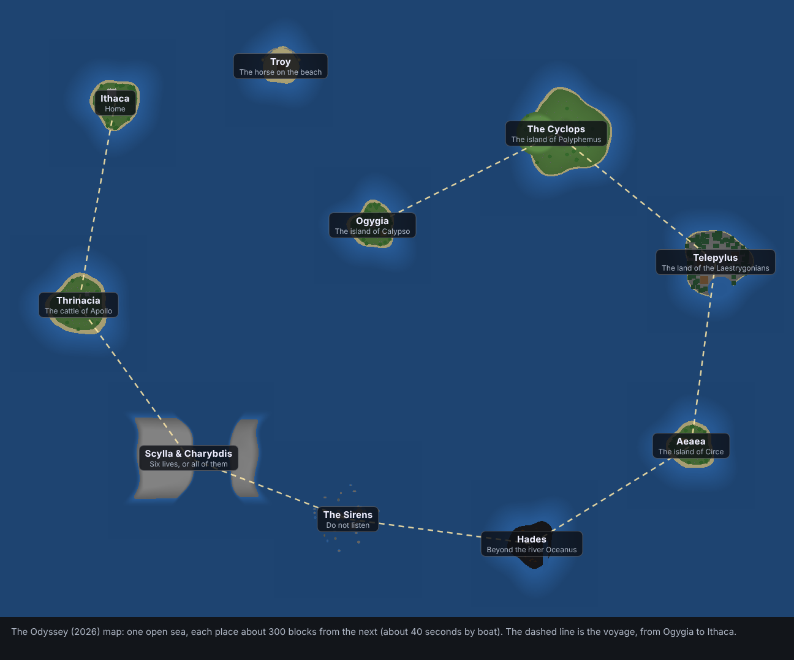

# Minecraft-Addon-Studio

Bedrock add-ons. `BP/` is the behavior pack, `RP/` is the resource pack.

## The Odyssey (2026)

The creatures and mythic encounters of Christopher Nolan's *The Odyssey*, built only from what the film shows:
their look, their proportions and what they do on screen. Each one is a cube model with an HD texture
(up to 64 px per block) and its own animations.

### Creatures

| Creature | In the film | In the game |
|---|---|---|
| **Polyphemus** `studio:cyclops` | A gangly, bald giant with pale, wrinkled elephantine skin, huge hands with broken nails, and one wide-open round eye with an amber iris, set crooked above a twisted nose and mouth. A shepherd who traps and devours men. | Stands **11 blocks** tall with a flock of 6 sheep. Moves: **devour** (scoops a man up, lifts him to his mouth, two bites, tosses him aside), **kick** (sends a man flying), **stomp** (on whatever is underfoot), **tend** (strokes his sheep) and **wake**. At night he sleeps. Hit him with the **Burning Stake** while he sleeps and he is blinded for good: his **cry** to Poseidon (*"Father Poseidon, they blinded me! Vengeance, father, vengeance for pain..."*) brings a storm. Blind, he passes over anyone standing among his sheep, and **throws** a rock at a boat he hears. The rocks always miss, as in the film. |
| **Laestrygonians** `studio:laestrygonian` | 4 m giants of Telepylus, corpulent, with broad, slightly arched shoulders, in smooth silver plate: a domed helmet with a beak-like ridge and a dark Y-shaped face opening, one great dome on each shoulder, a rounded breastplate with a band across the belly, flared forearm guards, a skirt of hanging plates, and bare hands. Their weapons: a sword the size of a ship's prow, a glaive, an all-metal mace and a great curved blade. | **4 blocks** tall, each with one of four weapons and its own move: the sword **slashes** (a wide sweep), the glaive **impales** (stab, lift, fling into the trees), the mace **crushes** (an overhead slam that also breaks boats) and the curved blade **cleaves** (a double sweep). Any weapon **smashes** a boat to pieces. Blades do half damage against their armour; arrows do full damage. Hurting one alarms the whole group, and they answer with a war cry. |
| **Laestrygonian child** `studio:laestrygonian_child` | Already the size of a grown man, in a quilted coat with plate. Asked for hospitality, the child laughs; asked again, the child screams and runs. | **Laughs** when you come close. If you stay, the child **screams**, runs and alarms every giant within 64 blocks. If no giants are near, three arrive. |
| **Circe** `studio:circe` | A witch on Aeaea with long dark hair going grey, living with her sister, whom she turned into a bird. The animals around her cottage were once sailors. She feeds the men stew if they leave their armour outside, then molds them into pigs with her hands. Odysseus grabs her sister and she stands down. | Spawns with her sister on her shoulder and three pigs. **Beg for Food**: she **serves** Circe's Stew only if you wear no armour; for armour she **screams**. Eat the stew and come near her, and she **molds** you into a pig for 10 minutes. **Seize Her Sister** (use the bird): the bird flaps, Circe yields, turns everyone back and gives her **counsel**: cross the river Oceanus into Hades. |
| **Sirens** `studio:siren` | Mermaids, seen as pale bodies lying on the sea rocks in the mist. Their song lures one sailor to take out his wax and swim off the ship. The crew stop their ears with wax. Odysseus, tied to the mast, hears everything he could ever want, and why he could never have it. | Evil mermaids lying on the rocks in a haze of mist: ash-pale skin, black eyes, long black hair and a scaled tail. They cannot be harmed. Moves: **sing** (the song pulls in and sickens everyone within 40 blocks; each player hears their own mix), **beckon** (calls one listener with a stronger pull) and **drag** (anyone who reaches the rocks is dragged under). **Wax** muffles the song for 5 minutes. In a boat you are tied to the mast: you hear the song but are not pulled. |
| **Scylla** `studio:scylla` | A six-headed monster in the cliff that snatches six men from the deck and carries them off to her cave. | Fixed in place and cannot be harmed. Five moves: her necks **lunge** out, then **snatch** up to **six** creatures within 18 blocks (one per head), **devour** them (three bites each) and **recoil**. An empty boat nearby is torn apart (**rend**). |
| **Charybdis** `studio:charybdis` | The whirlpool that would take the whole ship. | Forms on water near Scylla. It drags everything within 28 blocks into a spiral and **gulps** down boats and dropped items at its centre. Now and then the whirlpool **surges** and pulls much harder. |
| **Tiresias** and the **shades** `studio:tiresias`, `studio:shade` | In Hades, a sacrifice of sheep raises the dead. Sinon's shade reproaches Odysseus; Agamemnon's shade tells of his murder by Clytemnestra; blind Tiresias, shrouded and caked in black sand, prophesies. Then the unburied crew come for him. | Kill a **sheep** while standing on **soul sand, soul soil or black concrete powder**. Sinon, Agamemnon (black plumed helmet) and Tiresias **rise** from the ground and **speak** (each with their own move), then **sink** back. Tiresias says *"The Whirlpool in the sea takes all of your lives, the monster in the cliff only six."* Then six crew shades rise, run at you and **grasp** at you, and sink back after 90 s. |
| **Cattle of Apollo** `studio:sun_cattle` | On Thrinacia the starving men kill one of Apollo's cattle, and Zeus sends a storm that sinks the ship. | Long-horned cattle on the plains that **graze** and **low** when hurt. Kill one and a thunderstorm brings ten lightning strikes around you; the boat you ride is destroyed. |
| **Calypso** `studio:calypso` | The nymph of Ogygia, whose lotus flowers make Odysseus forget. | **Accept a Lotus**: she **offers** a Lotus Flower. Eating it takes all your XP levels (your memories) and leaves you calm and slowed. Sneak and use her to be **embraced**: a moment of healing. |
| **Athena** `studio:athena` | The goddess who protects Odysseus and commands him to return home. | **Speak with Athena**: she **blesses** you with Resistance for 4 minutes, once every 10 minutes. On the journey (in the map), when you are nearly dead she **appears** to you, bids you return home, and **vanishes**. |
| **Trojan Horse** `studio:trojan_horse` | Production designer Ruth De Jong's rearing 36 ft (11 m) horse. The Greeks hide inside it. | Stands **11 blocks** tall. **Hide Inside**: up to six players sit inside, turn invisible, and the belly hatch opens (**hatch**) as they climb in. At night the Greeks **sally** out: everyone inside is thrown out strengthened. |

### Items and recipes

| Item | How to get it | Use |
|---|---|---|
| Wax | 1 honeycomb gives 2 | Eat to stop the Sirens' song reaching you for 5 minutes |
| Burning Stake | flint over an oak log over coal (one column) | Strike Polyphemus with it while he sleeps |
| Circe's Stew | Circe gives it if you wear no armour | Filling food, but it leaves you pliable to Circe's hands |
| Lotus Flower | Calypso gives it | Eat to forget: removes your XP levels |

### Play the film in order

1. **The Cyclops:** let Polyphemus sleep at night, then strike with the burning stake. Hide among his flock and get to your boat.
2. **Telepylus:** in a taiga, do not linger near the armoured child.
3. **Aeaea:** take off your armour to eat Circe's stew (or don't), then seize her sister.
4. **Hades:** sacrifice a sheep on black sand to hear Tiresias, then run from the dead.
5. **The Sirens:** eat wax, or sail past bound to the mast.
6. **Scylla and Charybdis:** choose which one to pass.
7. **Thrinacia:** leave the cattle of Apollo alone.
8. **Ogygia:** Calypso's lotus, and Athena's command to go home.

### Moves, sounds and languages

Every move of every creature is its own **animation**, its own **script** and its own **sound**: `tools/odyssey/moves.py`
is the one table (length and key frames in seconds) that builds the animation, the animation-controller state, the
`studio:anim` value, the sound cues and the timing the script uses, so what you see, hear and take damage from happens
on the same frame. Footsteps fall on the heel strike of each walk cycle.

The sounds are **original and synthesised** (`tools/odyssey/sfx.py`): giant footfalls and breath, bronze armour, wet bites,
a siren choir, a storm. The film's own audio is copyrighted and is not used. The text is in **English and Russian**
(the film's quoted lines stay in English); each player reads the game in their own language.

### Playing together

Every state lives on the creature or on the player (dynamic properties), never in a global, so any number of players can
play at once: two giants can each carry a different man, wax muffles only the song of the player who ate it, the fog of a
place closes in on the player who is there and not on the others, and a player who leaves leaves no pig behind.

Natural spawns: Laestrygonians (groups of 2–3) and their child in taigas, Sirens on stony shores, the cattle of Apollo on
plains. Everything else comes from spawn eggs or `/summon`. Charybdis also forms on its own near Scylla.

### The map

`The_Odyssey_v<version>.mcworld` is a survival world with both packs inside: one open sea and, about 300 blocks apart
(roughly 40 seconds by boat), a place for each part of the film. You start on Ogygia with the crew's supplies (two boats,
wax and a burning stake) and sail the voyage; the title of each place appears as you reach it, and its fog closes in on
you alone.

| Place | What is built | Who lives there |
|---|---|---|
| **Ogygia** | Calypso's island: a stone shrine with the lodestone that marks the map, a lotus pool, her house | Calypso |
| **Troy** | A beach with the walls and towers of Troy and the platform of the horse | the 11-block Trojan Horse |
| **The Cyclops** | Hills with a 46-block cave and the stone that closes it, a sheepfold | Polyphemus and his flock |
| **Telepylus** | A harbour under cliffs, a quay, houses built for giants, a spruce forest, thick fog | the Laestrygonian child, then the giants |
| **Aeaea** | A meadow with Circe's cottage and the pigs' pen | Circe, her sister, three pigs |
| **Hades** | A plain of black sand, the altar for the blood, the river Oceanus running in from the sea, dark fog | three sheep to sacrifice |
| **The Sirens** | Sea stacks in the mist, three rocks to lie on | three Sirens |
| **Scylla and Charybdis** | A strait between two headlands, with Scylla's cave at the foot of one | Scylla; Charybdis forms in the water |
| **Thrinacia** | Rolling pasture and an altar of the sun | six of Apollo's cattle |
| **Ithaca** | A white house with columns | Athena |

There are no natural spawns in the map. A place's creatures appear when a player first comes near (the world remembers
that), and one that is killed returns ten minutes later. The script only does this when it finds the lodestone at the
marker position, so in an ordinary world the add-on behaves as before. Build the world (it needs
[Amulet](https://github.com/Amulet-Team/Amulet-Core), which runs on Python 3.12 or older):

    python3.12 -m venv .venv && .venv/bin/pip install amulet-core
    .venv/bin/python -m tools.odyssey.world        # writes dist/The_Odyssey_v<version>.mcworld, then reads it back and
                                                   # checks the marker, the ground and headroom at every spawn, and that
                                                   # every place can be reached by boat

### Install and test

On a phone or PC, open the `.mcworld` file (the map; the packs are inside it, so there is nothing else to enable) or
the `.mcaddon` file (build it with `python3 -m tools.odyssey.package`) and Minecraft imports it. After a `.mcaddon`,
enable **Odyssey Creatures BP** on a world (it adds the resource pack itself). For development, copy `BP/` into
`development_behavior_packs` and `RP/` into `development_resource_packs` instead.
The script uses the stable `@minecraft/server` 1.11.0 API, so no experimental toggles are needed.

    /summon studio:cyclops
    /summon studio:laestrygonian_child
    /summon studio:circe
    /summon studio:siren
    /summon studio:scylla
    /summon studio:sun_cattle
    /summon studio:calypso
    /summon studio:athena
    /summon studio:trojan_horse
    /give @s studio:burning_stake
    /give @s studio:beeswax 4
    /time set night

### For developers

- `python3 -m tools.odyssey.build` regenerates every model, texture, animation and pack file from `tools/odyssey/`
  (one module per creature, plus shared materials, body parts and checks). Before writing anything it checks that no
  part floats, no joint gaps, no textures overlap and no face is left invisible.
- `python3 -m tools.odyssey.validate` checks the finished packs: every JSON parses, manifest UUIDs are unique, and every
  geometry, texture, animation bone, render controller, property, event, item and language key that the packs and the
  script refer to exists.
- `python3 -m tools.odyssey.package` zips both packs into `dist/Odyssey_Creatures_v<version>.mcaddon`.
- `python3 -m tools.odyssey.sfx` renders the sounds (`RP/sounds/odyssey/*.ogg`, `sound_definitions.json`); `build` runs it
  when the recipes change. `moves.py` is the single source of truth for moves; `lang.py` for text; `world_plan.py` for
  the places of the map.
- `node --import ./tools/odyssey/jstest/register.mjs tools/odyssey/jstest/test.mjs` runs the script against a strict mock of
  `@minecraft/server` (property values are checked against the entity files, a removed entity throws when touched).
- `node tools/preview_render.js` renders a model to PNG, optionally posed (`npm i three playwright` first).
- Mechanics live in `BP/scripts/`: `main.js` (events and loops), `creatures/` (one module per group of creatures),
  `lib/` (move runner, holds, helpers), `world/` (the journey) and `data/` (generated).

Sources: the film's Wikipedia article (plot and production), film stills, the Villains Wiki and Odyssey fan-wiki
character pages, published reviews (including Collider's guide to the film's mythological figures), and viewers' accounts
of scenes the wikis do not describe.
